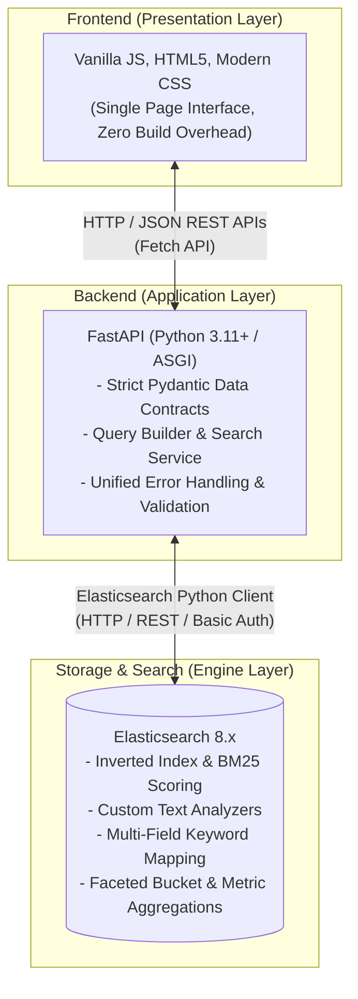

# System Architecture & Technical Rationale

**Digital Archival Registry & Museum Collection Tracker**

---

## 1. System Overview

The **Digital Archival Registry & Museum Collection Tracker** is a discovery and management platform designed specifically for historical artifacts, specimen collections, and archival documentation. The system is architected around a 3-tier modular design:

### Component Responsibilities

1. **Presentation Layer (`frontend/`)**:
   - Built with semantic HTML5, modern responsive CSS (custom properties, flexbox/grid), and modular vanilla JavaScript.
   - Communicates with the FastAPI backend using standard browser `fetch` calls.
   - Emphasizes high performance, zero build dependencies, accessibility, and immediate search-as-you-type feedback.

2. **Application Layer (`backend/`)**:
   - Built with **FastAPI** on Python 3.11+.
   - Enforces strict input validation and data contracts using **Pydantic v2** models.
   - Encapsulates Elasticsearch query generation, fuzzy search logic, filtering parameters, and aggregation processing inside dedicated service modules.
   - Provides standardized HTTP error formatting and interactive OpenAPI/Swagger documentation (`/docs`).

3. **Search & Persistence Engine (`elasticsearch/`)**:
   - Runs **Elasticsearch 8.17.x** in a pinned, single-node Docker Compose setup.
   - Serves as the primary datastore and query engine for archival records.
   - Leverages inverted indexes for sub-millisecond full-text retrieval, BM25 scoring for ranking archival relevance, and aggregations for faceted filtering.

---

## 2. Technical Rationale: Why Elasticsearch for Archival Collections?

Museum collection databases present distinct engineering requirements that fundamentally differ from standard transactional systems (like e-commerce checkout or billing ledgers). Archival records are semi-structured, content-dense, and discovery-centric.

### A. The Document Model for Archival Entities
Archival items are heterogeneous documents rather than uniform relational rows. A single artifact record includes:
- Scalar metadata (accession number, acquisition date, estimated value).
- Unstructured, lengthy narrative prose (historical background, provenance trail, curator notes, restoration logs).
- Array collections (materials, tags, alternative titles).
- Structured dimensional attributes (height, width, depth, display parameters).

In a traditional relational model, capturing this structure requires extensive table normalization (`artifacts`, `artifact_materials`, `artifact_dimensions`, `restoration_logs`, `provenance_entries`) joined across 5–7 foreign keys on every query. In Elasticsearch, the artifact is persisted as a single, self-contained JSON document that can be indexed, retrieved, and updated atomically.

### B. The Inverted Index vs. Relational B-Trees
- **Relational Databases (B-Trees)** index values in ordered trees, making exact lookups (`WHERE accession_number = 'ARC-2024-001'`) and ranges (`WHERE year >= 1500`) efficient. However, matching text across multiple narrative fields (`WHERE description LIKE '%bronze%' OR historical_context LIKE '%bronze%'`) triggers expensive full-table scans or slow substring matches.
- **Elasticsearch (Inverted Index)** tokenizes text into distinct terms and constructs posting lists mapping each token to the document IDs containing it. Searching across hundreds of words in thousands of artifacts executes in single-digit milliseconds because Elasticsearch looks up terms directly in the dictionary rather than scanning document contents.

### C. Relevance Ranking & BM25 Scoring
Museum searches require intelligent ranking rather than binary boolean filtering:
- If a curator searches for *"dynastic bronze sacrificial vessel"*, an item whose title contains all four words must rank significantly higher than an item that merely mentions *"bronze"* in its restoration notes.
- Elasticsearch uses the **Okapi BM25** ranking algorithm, factoring in:
  1. **Term Frequency (TF)**: How often the search term appears in the specific field.
  2. **Inverse Document Frequency (IDF)**: Rare terms across the collection (e.g., *"sacrificial"*) carry more weight than common terms (e.g., *"vessel"*).
  3. **Field-Length Normalization**: Matches in shorter fields (like an artifact name) receive higher relevance than matches in long paragraphs of description.
  4. **Field Boosting**: We can explicitly assign search weights (e.g., `name^3`, `description^1.5`, `restoration_notes^1.0`).

### D. Typo-Tolerance and Fuzzy Search
Historical names, cultures, and archaeological terms often suffer from spelling variants or transcription errors (e.g., *"Mesopotamian"* vs. *"Mesapotamian"*, *"Pharaoh"* vs. *"Pharoah"*). Elasticsearch provides native query-time **Levenshtein distance fuzziness** (`fuzziness: "AUTO"`), enabling resilient discovery without requiring exact dictionary matches.

### E. Real-Time Faceted Aggregations
A cornerstone of archival research is faceted navigation: exploring the collection by historical period, material, conservation condition, and era.
- In SQL, computing facets across multiple columns requires multiple `GROUP BY` queries or complex CTEs that re-scan filtered tables.
- In Elasticsearch, search queries and multi-dimensional aggregations (bucket aggregations for categories and conditions, metric aggregations for min/max/average estimated values) are evaluated simultaneously in a single distributed pass over the filtered doc values.

---

## 3. Elasticsearch vs. Relational Databases (Trade-Off Analysis)

| Architectural Dimension | Elasticsearch | Relational Database (e.g., PostgreSQL) | Architectural Rationale for This Application |
| :--- | :--- | :--- | :--- |
| **Primary Data Structure** | Inverted index + Lucene segment store (JSON documents) | B-Tree / WAL / Row-oriented or columnar tables | Archival artifacts are natural documents with nested attributes and rich narrative text. |
| **Full-Text Retrieval** | Native BM25 scoring, tokenizers, stemmers, field boosting | `tsvector` / GIN indexes (capable, but configuration-heavy and limited ranking nuances) | Museum researchers rely on relevance-ranked results and term weighting across multiple narrative fields. |
| **Fuzzy & Typo Matching** | Built-in Levenshtein automata (`fuzziness: AUTO`) | Requires extensions (`pg_trgm`), custom similarity thresholds, or manual regex | Native tolerance for varied historical spellings and user search typos. |
| **Faceted Navigation** | High-performance bucket & metric aggregations executed during search | Multiple `GROUP BY` passes or complex composite indexes | Delivers instant interactive category counts, era breakdowns, and value statistics alongside query hits. |
| **ACID Guarantees** | Document-level atomicity; no multi-document transactions | Full multi-table ACID transactions, strict serializability | Museum cataloging is predominantly read-heavy discovery and curation. Single-document atomicity is sufficient. |
| **Referential Integrity** | No foreign keys; denormalized document modeling | Strict foreign key constraints and schema enforcement | Application-tier validation (via Pydantic) guarantees schema integrity without database join locks. |
| **Consistency Model** | Near Real-Time (NRT) due to index refresh interval (default 1s) | Immediate read-after-write consistency | A 1-second refresh latency is completely imperceptible for archival cataloging and exploration. |
| **Memory Footprint** | Higher (JVM heap, fielddata, doc values caches) | Lower baseline memory usage for small datasets | Controlled via Docker Compose memory limits (`-Xms512m -Xmx512m`) for predictable local development. |

### When Would a Relational Database Be Preferred?
A relational database would be preferable if the application scope shifted to:
- High-concurrency financial transactions (e.g., museum ticketing, gift shop inventory, donor billing) requiring strict two-phase commits across multiple accounts.
- Deep relational graphs (e.g., recursive donor ownership trees requiring recursive SQL CTEs).

For this application, Elasticsearch is the optimal primary datastore because **retrieval quality, faceted exploration, and relevance ranking are core product capabilities**, not secondary features.

---

## 4. Index Mapping & Text Analysis Strategy

To prevent dynamic mapping pitfalls (such as unwanted type coercions or unoptimized text fields), the system utilizes an explicit mapping configuration (`elasticsearch/mappings/artifacts_mapping.json`):

1. **Multi-Field Mapping (`text` + `keyword`)**:
   - Fields such as `name`, `origin_location`, and `accession_number` use multi-fields:
     - The `text` representation enables tokenized, stemmed full-text search.
     - The `.keyword` subfield (e.g., `name.keyword`) enables exact-match filtering, alphabetized sorting, and term aggregations.
2. **Text Analyzers**:
   - Narrative fields (`description`, `historical_context`, `provenance`, `restoration_notes`) utilize language analyzers (lowercasing, punctuation stripping, English algorithmic stemming).
   - Identifiers (`accession_number`, `artifact_id`) utilize exact `keyword` types to prevent tokenization.
3. **Structured Fields**:
   - `category`, `historical_period`, `condition`, `storage_location` are mapped as `keyword` for exact filtering and fast bucket aggregations.
   - `estimated_value` is mapped as `scaled_float` or `double` for range queries and metric aggregations.
   - `acquisition_date` is mapped as `date` with standardized ISO-8601 parsing.

---

## 5. Security & Operational Posture

### Local Development Environment
- **Pinned Containers**: Container images are pinned to `docker.elastic.co/elasticsearch/elasticsearch:8.17.2` to eliminate runtime variance between environments.
- **Network Isolation**: The Elasticsearch port mapping is explicitly bound to `127.0.0.1:9200:9200`. This isolates the engine from public or local area network interfaces.
- **Authentication**: `xpack.security.enabled=true` enforces HTTP Basic Authentication via an environment-configured password (`ELASTIC_PASSWORD`).
- **Transport Security Choice**: `xpack.security.http.ssl.enabled=false` is configured specifically for local development to avoid complex self-signed certificate distribution in Python client environments, while still maintaining authenticated access control. Production deployments must enable TLS certificates.
